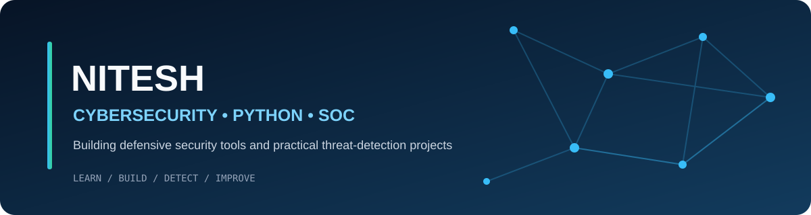

### Cybersecurity Student | Python Developer | SOC & Threat Detection Enthusiast

Building practical, explainable cybersecurity projects across defensive tooling, phishing triage, SOC detection engineering, and SIEM workflows.

---

## 👨‍💻 About Me

- 🎓 Student focused on cybersecurity and practical software development.
- 🔐 Interested in Security Operations (SOC), threat detection, incident response, and ethical hacking.
- 🐍 Build projects using Python, APIs, databases, and web technologies.
- 🧪 Learn through hands-on labs, defensive security tooling, and technical documentation.
- 🎯 Career goal: grow into a cybersecurity professional through continuous learning and real-world practice.

## 🧰 Technical Skills

**Programming & Development**

**Cybersecurity & SOC**

**Tools & Platforms**

## 🚀 Featured Projects

### 🔹 [Advanced Cyber Security Toolkit](https://github.com/Nitesh715/Advanced-Cyber-Security-Toolkit)
Python desktop toolkit for authorized defensive security checks, including network utilities, vulnerability checks, packet analysis, log analysis, file integrity verification, and reporting.

### 🔹 [AI Cyber Security Copilot](https://github.com/Nitesh715/AI-CyberSecurity-Copilot)
FastAPI and browser-based defensive URL risk-analysis tool with explainable heuristic signals and recommended response guidance. **Current scoring is heuristic-based, not a trained ML model.**

### 🔹 [Mini-SOC Workbench](https://github.com/Nitesh715/Mini-SOC-Workbench)
Offline-first SOC lab with event ingestion, configurable detection rules, alert correlation, analyst case triage, and ATT&CK technique mapping.

### 🔹 [Threat Detection Mapped to MITRE ATT&CK](https://github.com/Nitesh715/Threat-Detection-Mapped-to-MITRE-ATTACK)
Detection-engineering project mapping rule-based detections to MITRE ATT&CK tactics and techniques, with event exploration and case investigation workflows.

### 🔹 [AI-Powered Mini SIEM](https://github.com/Nitesh715/AI-Powered-Mini-SIEM-)
Flask and SQLite learning SIEM for CSV/JSON log ingestion, explainable risk scoring, alert generation, and dashboard-based event review. **The current version uses transparent rules, not a trained AI model.**

## 🎯 Current Learning Focus

- Security monitoring and SIEM operations
- Detection engineering and MITRE ATT&CK mapping
- Python automation for defensive security
- Network security and vulnerability assessment
- Incident triage, log analysis, and security reporting

## 📊 GitHub Overview

---

**Thanks for visiting my profile!**  
*Learn continuously. Build responsibly. Secure by design.*

